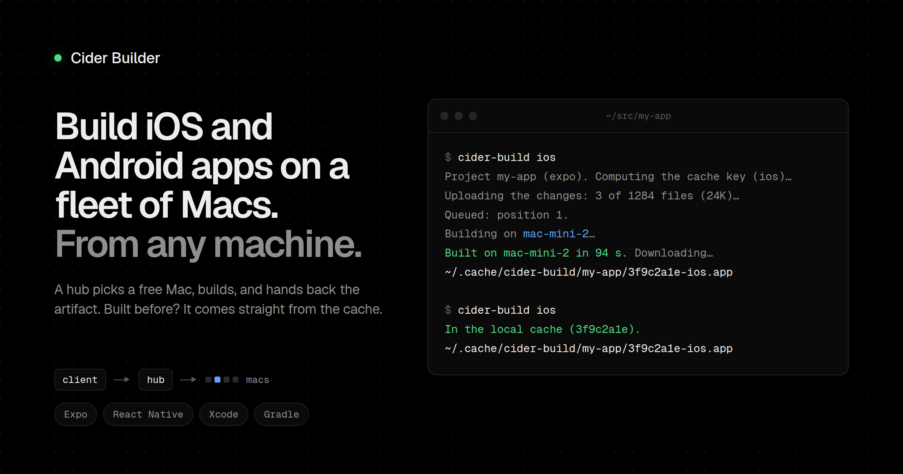

# Cider Builder



Build iOS and Android apps on a fleet of Macs from any Linux or macOS machine.

You run `cider-build ios` in a project folder. A hub picks a free Mac, builds the simulator `.app` or the `.apk` there, and returns it. If that native version was built before, the hub returns it from its cache and nothing builds.

It supports Expo, React Native, native iOS (Xcode), and native Android (Gradle) projects.

```bash
cider-build ios                 # the last line is the path of the .app
cider-build android ~/src/app   # the last line is the path of the .apk
cider-build warm                # start both builds on the hub and return right away
cider-build status              # Macs, builds in progress, and the queue
```

## How it works

- The **hub** is one Mac that runs `cider-build-hub`. It owns the queue, the Macs, and the cache, and it serves a web panel.
- Each **builder Mac** runs `cider-build-worker`. The agent sends a heartbeat every 2 s, takes jobs, runs `build.sh`, and uploads the result.
- Each **client** runs `cider-build`. It computes a cache key for the project, uploads only the files the hub lacks, and downloads the result.

Everything talks over a [Tailscale](https://tailscale.com) tailnet. Clients talk only to the hub, over HTTPS. The hub never logs into the Macs. The Macs pull work from the hub. The tailnet policy is the access control, so there are no tokens.

The code is Bash and Python 3.9 with no dependencies.

## Requirements

- A tailnet with MagicDNS and HTTPS certificates turned on.
- A Mac for the hub, with `/usr/bin/python3` and Tailscale.
- Apple Silicon Macs to build, with Xcode installed. The installer adds Homebrew, node, CocoaPods, xcodegen, JDK 17, and the Android SDK.
- Clients with bash, curl, python3, tar, and git. Expo and React Native projects also need node and their `node_modules`.

## Quick start

The examples use `buildhub` as the hub's tailnet name and `example.ts.net` as the tailnet domain.

1. On the hub Mac, install the server:

   ```bash
   git clone https://github.com/dtowers10/cider-builder.git && cd cider-builder
   ./install.sh hub
   ```

2. On each Mac that builds, as the user that builds, run:

   ```bash
   curl -fsSL http://buildhub:4711/join | bash
   ```

3. On each client, install `cider-build`:

   ```bash
   curl -fsSL https://buildhub.example.ts.net:4710/bin/install.sh | bash -s client
   ```

4. In an app folder, build:

   ```bash
   cider-build ios
   ```

To let coding agents build for you, install the `cider-build` skill. It works with Claude Code, Cursor, Codex, and the other agents that [`npx skills`](https://skills.sh) supports:

```bash
npx skills add dtowers10/cider-builder --skill cider-build -g
```

Run `install.sh` again at any time to update. It leaves in place anything that is already installed. To add a Mac from a client over Tailscale SSH, run `cider-build add <mac>`. To remove a Mac from the fleet, run `cider-build remove <mac>`.

The panel is at `https://buildhub.example.ts.net:4710/`. Its Board shows one cell per slot, with the build that runs there and its estimated time left, and the queue with where and when each build should start. It also has live logs, history and the cache. Its Fleet view lists the Macs, shows the commands to add one, and updates the hub from git and the agents from the hub.

## Project settings

A project can add a `.cider-build.json` file:

```json
{
  "ios": { "scheme": "MyApp", "workspace": "ios/MyApp.xcworkspace", "configuration": "Debug" },
  "android": { "task": "assembleDebug", "apk": "android/app/build/outputs/apk/debug/app-debug.apk" }
}
```

`ios.project` can replace `ios.workspace`. `CIDER_BUILD_FORCE=1` skips the caches and uploads the whole project.

## Documentation

- [Installation](docs/installation.md) explains each step of the hub, client, and Mac installers, plus `hub-install`, `add`, and `remove`.
- [Configuration](docs/configuration.md) lists the hub settings in `hub.json` and their environment variables.
- [The panel and updates](docs/updates.md) covers hub updates from git, agent updates, deploy keys, and rollback.
- [Using cider-build](docs/usage.md) covers `warm` and its post-merge hook, incremental uploads, and when a build is cancelled.
- [Upgrading](docs/upgrading.md) covers a move from mac-build, the project's former name, and from a hub older than `hub.json`.
- [Verification](docs/verification.md) describes the TLA+ model of the job protocol and the test scripts.

## Development

The repository has these parts:

| File | Runs on | What it does |
|---|---|---|
| `bin/cider-build` | Linux or macOS | Client: `cider-build ios`, `cider-build android`, `cider-build status`, `hub`, `add`, `remove` and `hub-install` |
| `bin/cider-build-hub` | Hub (Mac) | HTTP server on 127.0.0.1:4710, published with `tailscale serve`, and on the tailnet IP, port 4711, for `/join`. It is the single source of truth for the queue, the Macs, affinity and the cache. |
| `bin/cider-build-panel.html` | Hub (Mac) | The web panel that `cider-build-hub` serves at `/` |
| `bin/fonts/` | Hub (Mac) | Geist and Geist Mono (OFL license) for the panel, served by the hub at `/fonts/` |
| `bin/cider-build-worker` | Each builder Mac | Agent that sends a heartbeat every 2 s with the RAM and the Mac's details (name, IPs, chip, macOS), receives jobs, runs `build.sh` and delivers the result |
| `bin/build.sh` | Each builder Mac | The build: dependencies, `expo prebuild`, `pod install`, `xcodebuild` or `gradlew` |
| `verification/` | Any machine with Java | TLA+ model of the hub ↔ agents protocol and its check |
| `skills/cider-build/` | Coding agents | The agent skill that `npx skills add` installs |
| `install.sh` | Hub, clients and builder Macs | Installs or updates the server (`install.sh hub`), the client (`install.sh client`) or a builder Mac (`install.sh worker`, what `/join` serves) |

The Python tests run on Linux with fakes for the macOS tools and touch no network:

```bash
python3 verification/hub-smoke.py        # one of the scripts in verification/; CI runs them all
verification/verify.sh                   # TLA+ model check; needs Java 11 or later and downloads tla2tools.jar once
```

CI also runs `bash -n`, `shellcheck`, and `py_compile` on every script.

## License

[MIT](LICENSE). The Geist fonts in `bin/fonts/` are under the SIL Open Font License, in `bin/fonts/OFL.txt`.
